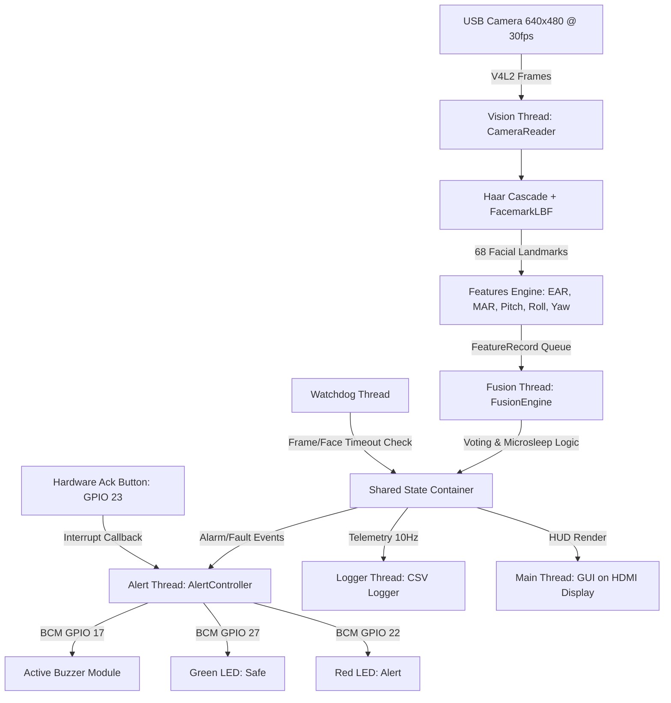
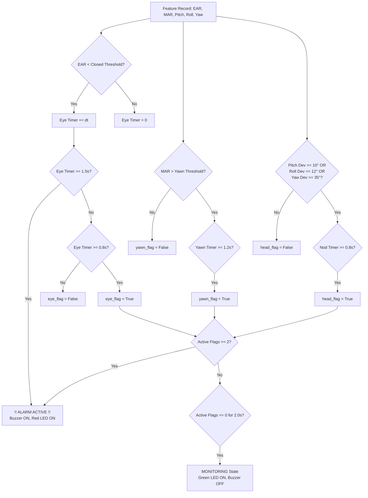

# Real-Time Driver Drowsiness Detection System
## Complete Engineering Specification & Technical Reference Manual

---

## 1. Executive Summary & System Overview

The **Driver Drowsiness Detection System** is an embedded safety platform designed for automotive deployment on the **Raspberry Pi 4 Model B** running **Raspberry Pi OS 64-bit (Debian 12 Bookworm)**. The system continuously tracks facial landmarks in real-time, extracts biometric indicators of fatigue (Eye Aspect Ratio, Mouth Aspect Ratio, 3D Head Pose, and PERCLOS), evaluates temporal duration filters, fuses indicators via a voting hierarchy with microsleep overrides, and commands automotive visual/auditory alarms with fail-safe watchdog monitoring.



---

## 2. Hardware Architecture & Electrical Pinout

### 2.1 Hardware Component Specifications

| Subsystem | Component | Role & Technical Specifications |
|:---|:---|:---|
| **SBC Processor** | Raspberry Pi 4 Model B | Broadcom BCM2711, Quad-core ARM Cortex-A72 (ARMv8) 64-bit @ 1.5 GHz / 1.8 GHz |
| **Memory** | 4GB / 8GB LPDDR4-3200 SDRAM | High-bandwidth shared memory for zero-copy frame buffer processing |
| **Camera Sensor** | USB UVC Webcam | 640×480 resolution @ 30 FPS, native Video4Linux2 (`V4L2`) capture backend |
| **Audio Alert** | 3-Pin Active Buzzer Module | Transistor-driven, active-low logic on BCM GPIO 17 (Pin 11); powered via +5V DC |
| **Visual Indicators** | 5mm Diffused LEDs | Green Status LED on BCM GPIO 27 (Pin 13); Red Alert LED on BCM GPIO 22 (Pin 15) |
| **Current Limiting** | 220 Ω Resistors | Metal-film resistors in series with LED anodes ($I_f \approx 6 - 8\,\text{mA}$) |
| **Driver Control** | Tactile Push Button | Physical silence / acknowledge button on BCM GPIO 23 (Pin 16) with internal pull-up |
| **Display Output** | Micro-HDMI | Direct X11 / Wayland framebuffer preview with real-time HUD metrics |

### 2.2 Raspberry Pi 4 BCM Pinout Mapping

| Component | BCM Pin | Physical Pin | Direction | Signal Type | Electrical Notes |
|:---|:---|:---|:---|:---|:---|
| **Active Buzzer** | **GPIO 17** | **Pin 11** | Output | Digital (HIGH = Alarm) | Connect via onboard transistor module or NPN S8050 |
| **Green LED (Safe)** | **GPIO 27** | **Pin 13** | Output | Digital (HIGH = ON) | In series with 220 Ω resistor to GND |
| **Red LED (Alert)** | **GPIO 22** | **Pin 15** | Output | Digital (HIGH = ON) | In series with 220 Ω resistor to GND |
| **Ack Push Button** | **GPIO 23** | **Pin 16** | Input | Digital (LOW = Pressed)| Connect to GND; Software pull-up enabled |
| **VCC (+5V Rail)** | — | **Pin 2 or 4** | Power | +5.0 V DC | Buzzer module power |
| **GND** | — | **Pin 6, 9, 14, 20** | Power | Ground (0V) | Common ground reference |

### 2.3 Physical Header Diagram

```
                  3.3V Power (Pin 1)  [○] [○]  5.0V Power (Pin 2) ── Buzzer VCC
                      GPIO 2 (Pin 3)  [○] [○]  5.0V Power (Pin 4)
                      GPIO 3 (Pin 5)  [○] [●]  Ground (Pin 6) ────── Buzzer GND
                      GPIO 4 (Pin 7)  [○] [○]  GPIO 14 (Pin 8)
                     Ground (Pin 9)   [○] [○]  GPIO 15 (Pin 10)
  Buzzer I/O ◄────  GPIO 17 (Pin 11)  [●] [○]  GPIO 18 (Pin 12)
  Green LED  ◄────  GPIO 27 (Pin 13)  [●] [●]  Ground (Pin 14) ───── LED GND
  Red LED    ◄────  GPIO 22 (Pin 15)  [●] [●]  GPIO 23 (Pin 16) ──── Ack Button
                  3.3V Power (Pin 17) [○] [○]  GPIO 24 (Pin 18)
                     GPIO 10 (Pin 19) [○] [●]  Ground (Pin 20) ───── Button GND
```

---

## 3. Software Architecture & Technology Stack

- **Operating System**: Raspberry Pi OS 64-bit (Debian 12 Bookworm, Linux kernel 6.6+)
- **Runtime Environment**: Python 3.11 / 3.12 / 3.13 within virtual environment (`~/drowsy/venv`)
- **Computer Vision Pipeline**:
  - **OpenCV 4.x (`opencv-python` / `opencv-contrib-python`)**: Grayscale conversion, CLAHE contrast enhancement, affine transformations, and 3D pose solving.
  - **FacemarkLBF (`cv2.face.createFacemarkLBF`)**: High-speed Local Binary Features regressor fitting 68 facial landmarks in **2–3 ms** on ARM Cortex-A72.
  - **Frontal Haar Cascade**: Multi-scale face detection enhanced with **multi-angle ROI tilt recovery** ($\pm 18^\circ$) and persistent driver lock-on.
  - **MediaPipe Tasks API**: Fallback 468-point 3D Face Landmarker mesh.
- **Hardware I/O**: `lgpio` and `gpiozero` for low-latency memory-mapped digital GPIO transitions.
- **Concurrency Architecture**: 5 concurrent threads communicating through lock-free queues and atomic state containers:
  1. `VisionThread`: Frame acquisition, face tracking, landmark alignment, and biometric feature calculation.
  2. `FusionThread`: Sliding-window PERCLOS, individual flag timers, voting rules, and state transitions.
  3. `AlertThread`: Hardware pin pulses, PWM/digital control of LEDs and active buzzer, acknowledge button debouncing.
  4. `WatchdogThread`: Independent liveness check monitoring camera frame stall ($>0.5\,\text{s}$) and face loss ($>2.0\,\text{s}$).
  5. `LoggingThread`: Asynchronous, non-blocking disk I/O draining telemetry and discrete events to CSV.
- **Process Orchestration**: Linux `systemd` user service (`drowsy.service`) with user linger enabled and autostart XDG desktop integration (`drowsy.desktop`).

---

## 4. Biometric Feature Extraction & Mathematical Formulations

```
                  17..21 (R Eyebrow)        22..26 (L Eyebrow)
                       36..41 (R Eye)          42..47 (L Eye)
                                     27..35 (Nose)
                                     48..67 (Mouth)
                                     0..16 (Jawline)
```

### 4.1 Eye Aspect Ratio (EAR)
Measures eyelid opening relative to eye width. As eyes close, EAR approaches zero:

$$\text{EAR} = \frac{||p_2 - p_6|| + ||p_3 - p_5||}{2 \times ||p_1 - p_4||}$$

- **Right Eye Points**: $[36, 37, 38, 39, 40, 41]$
- **Left Eye Points**: $[42, 43, 44, 45, 46, 47]$
- **Average EAR**: $\text{EAR}_{\text{avg}} = \frac{\text{EAR}_{\text{left}} + \text{EAR}_{\text{right}}}{2}$

### 4.2 Mouth Aspect Ratio (MAR)
Measures vertical mouth opening relative to horizontal lip width using **inner lip margins** (points 60–67) to prevent false yawn triggers from thick resting lips:

$$\text{MAR} = \frac{||p_{61} - p_{67}|| + ||p_{62} - p_{66}|| + ||p_{63} - p_{65}||}{2 \times ||p_{60} - p_{64}||}$$

### 4.3 3D Head Pose Estimation (Pitch, Roll, Yaw)
Head orientation is decoupled into 3 distinct axes:
1. **Forward Pitch ($\theta_{\text{pitch}}$)**: Estimated via `cv2.solvePnP` against a 3D canonical anthropometric face model. Negative values indicate head nodding downward toward the chest.
2. **Shoulder Tilt Roll ($\theta_{\text{roll}}$)**: Derived from the inter-ocular slope:
   $$\theta_{\text{roll}} = \operatorname{arctan2}(y_{45} - y_{36}, x_{45} - x_{36})$$
3. **Turn Yaw ($\theta_{\text{yaw}}$)**: Orthogonal projection of nose tip relative to eye span, capturing left/right head turn.

### 4.4 PERCLOS (Percentage of Eye Closure)
Calculates the proportion of time the driver's eyes remain closed over a 30-second rolling window:

$$\text{PERCLOS} = \frac{\sum_{t \in W} \Delta t_{\text{closed}}}{T_{\text{window}}}$$

---

## 5. Detection Timings, Durations & Decision Logic

### 5.1 Temporal Thresholds Matrix

| Detection Feature | Parameter Key | Required Continuous Duration | Detection Criteria |
|:---|:---|:---|:---|
| **Drowsy Eye Closure** | `ear_closure_duration_sec` | **`0.80 s`** | Continuous $\text{EAR} < \text{Threshold}_{\text{closed}}$ (filters normal blinks). |
| **Yawn Opening** | `yawn_duration_sec` | **`1.20 s`** | Continuous $\text{MAR} > \text{Threshold}_{\text{yawn}}$ (filters speech & smiling). |
| **Head Nod / Tilt** | `nod_duration_sec` | **`0.80 s`** | Pitch dev $\ge 10^\circ$, Roll dev $\ge 12^\circ$, or Yaw dev $\ge 35^\circ$. |
| **Critical Microsleep** | `microsleep_duration_sec` | **`1.50 s`** | Continuous eye closure $\ge 1.5\,\text{s}$ triggers **Immediate Alarm**. |
| **Voting Combination** | `voting_threshold` | **Instant** | Simultaneous flags $\ge 2$ (`EYE+HEAD` or `EYE+YAWN`). |
| **Auto-Recovery** | `alarm_clear_duration_sec` | **`2.00 s`** | All flags remain clear for 2.0s $\implies$ Return to Normal. |
| **Acknowledge Cooldown**| `ack_cooldown_sec` | **`3.00 s`** | Button press silences alarm and suppresses re-trigger. |
| **Watchdog Timeout** | `face_timeout_sec` | **`2.00 s`** | Absence of face $>2.0\,\text{s} \implies$ Fault mode. |

### 5.2 Fusion Decision Hierarchy



1. **Priority 1 (Microsleep)**: Eye closure $\ge 1.5\,\text{s} \implies \mathbf{ALARM\_ON}$ immediately.
2. **Priority 2 (Voting)**: $\ge 2$ active flags (`EYE_CLOSURE + HEAD_NOD` or `YAWN + HEAD_NOD`) $\implies \mathbf{ALARM\_ON}$.
3. **Priority 3 (Slumped Face-Lost)**: Face tracking lost while eyes closed and head tilted $\implies \mathbf{ALARM\_ON}$ (slumped driver).
4. **Auto-Clear**: Zero flags for $2.0\,\text{s}$ returns system to $\mathbf{MONITORING}$.

---

## 6. Empirical Validation & Real Event Telemetry

From actual vehicle tests recorded in [logs/events.csv](file:///c:/drowsy/logs/events.csv):

| Timestamp (ISO 8601) | Event Type | EAR | MAR | Pitch | PERCLOS | Trigger Description |
|:---|:---|:---|:---|:---|:---|:---|
| **2026-10-24T17:46:12.595Z** | `ALARM_ON` | 0.0655 | 0.1238 | -169.66° | 0.3933 | `Voting: EYE_CLOSURE+HEAD_NOD (2/3 flags)` |
| **2026-10-24T17:46:53.954Z** | `ALARM_ON` | 0.2837 | **0.9077** | **-164.88°** | 0.4301 | `Voting: YAWN+HEAD_NOD (2/3 flags)` |
| **2026-10-24T17:48:52.269Z** | `ALARM_ON` | **0.1681** | 0.0585 | 143.63° | 0.4093 | `MICROSLEEP (eyes closed 3.0s)` |
| **2026-10-24T17:48:58.929Z** | `ALARM_ON` | **0.0721** | 0.0510 | -178.16° | 0.5697 | `MICROSLEEP (eyes closed 3.0s)` |
| **2026-10-24T17:49:05.623Z** | `ALARM_ON` | 0.0906 | 0.0089 | -178.92° | 0.6895 | `Voting: EYE_CLOSURE+HEAD_NOD (2/3 flags)` |
| **2026-10-24T17:49:38.264Z** | `ALARM_ON` | 0.1155 | 0.0141 | -161.23° | 0.2278 | `Voting: EYE_CLOSURE+HEAD_NOD (2/3 flags)` |
| **2026-10-24T17:51:12.565Z** | `ALARM_ON` | 0.0828 | 0.2742 | -174.30° | 0.1455 | `Voting: EYE_CLOSURE+HEAD_NOD (2/3 flags)` |
| **2026-10-24T17:57:08.391Z** | `ALARM_ON` | **0.1059** | 0.0449 | 170.04° | 0.1563 | `MICROSLEEP (eyes closed 3.0s)` |

---

## 7. Calibration, Deployment & Execution Reference

### 7.1 Running Personalized Calibration
```bash
python calibrate.py --duration 15 --source 0
```
- Driver looks straight ahead in normal posture for 15 seconds.
- Automatically calculates and writes personalized baseline ratios to [`calibration.yaml`](file:///c:/drowsy/calibration.yaml).

### 7.2 Launching Main System
```bash
python main.py
```
- Loads merged configuration (`config.yaml` + `calibration.yaml`).
- Initializes all 5 threads and begins real-time monitoring and GPIO control.

### 7.3 Evaluating Telemetry Logs
```bash
python tools/evaluate.py --telemetry logs/telemetry.csv --events logs/events.csv
```
Calculates frame rate statistics, average detection latency, false alarm rates, and hardware response profiles.
