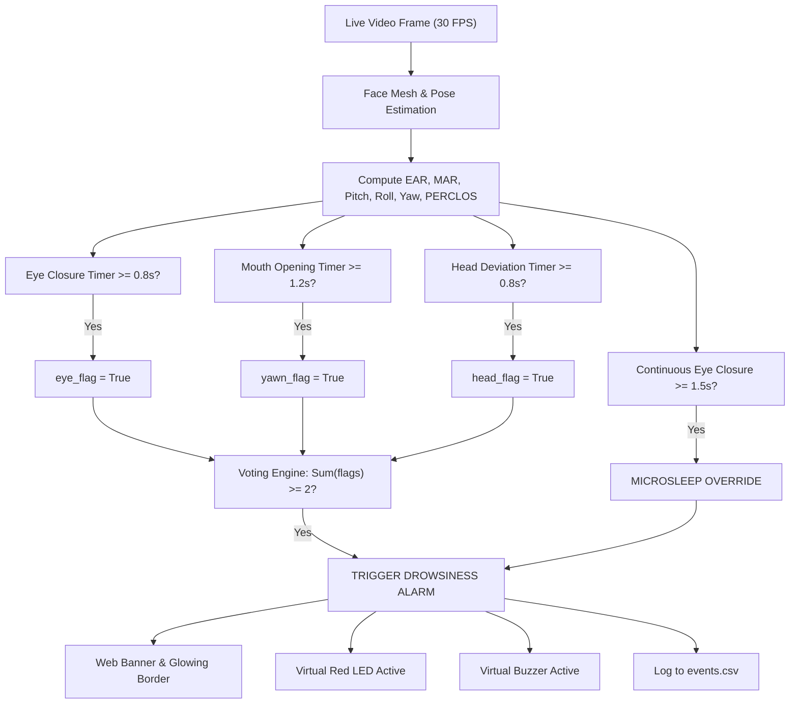

# Driver Drowsiness Detection System & Web Dashboard
## Complete Engineering Specification & Project Documentation (Laptop & Software Edition)

> **Document Scope**: Complete technical specification of the computer vision algorithms, mathematical formulas, detection thresholds, temporal fusion logic, software architecture, telemetry logging, and the unified real-time web dashboard. *(Embedded hardware/Raspberry Pi GPIO wiring is omitted as requested).*

---

## 1. System Overview

The **Driver Drowsiness Detection System** is an edge-capable, multi-sensor computer vision application designed to continuously monitor a driver's vigilance and detect early indicators of fatigue, drowsiness, microsleep, nodding, and distraction.

### Core Capabilities
- **Real-Time Facial Landmark Tracking**: 478 3D facial mesh points captured via webcam at 30 FPS.
- **Multimodal Feature Extraction**:
  - **Eye Aspect Ratio (EAR)** for blink and eye-closure detection.
  - **Mouth Aspect Ratio (MAR)** for yawn detection.
  - **3D Head Pose Estimation** (Pitch, Roll, Yaw) for nodding and inattention tracking.
  - **PERCLOS** (Percentage of Eye Closure) over a sliding 30-second window.
- **Personalized Driver Calibration**: 15-second baseline capture establishing driver-specific resting EAR, resting mouth dimensions, and upright sitting posture.
- **Temporal Sensor Fusion**: Multi-sensor voting engine (2-of-3 threshold) combined with a priority microsleep override.
- **Unified Web Dashboard**: Responsive, offline-safe light-theme monitoring interface featuring live MJPEG video with facial mesh overlays, real-time Canvas 2D waveform traces, virtual hardware indicators, and live event logging.

---

## 2. Software Technology Stack

| Layer | Component | Implementation Details |
| :--- | :--- | :--- |
| **Runtime Environment** | Python 3.12 | Standard Python 64-bit interpreter |
| **Computer Vision** | OpenCV (`cv2`) 4.10+ | Video I/O (`VideoCapture` with DirectShow on Windows), image processing, `solvePnP`, image encoding |
| **Facial Landmark Mesh** | MediaPipe Tasks API | `face_landmarker.task` model (478 3D landmarks, normalized coordinates) with FacemarkLBF fallback |
| **Numerical Math** | NumPy | Vectorized Euclidean distance, linear algebra, rotation matrices |
| **Web Server / API** | FastAPI + Uvicorn | Asynchronous ASGI server running locally on `http://127.0.0.1:8000` |
| **Concurrency Model** | Python `threading` | Independent daemon threads: Vision thread, Fusion thread, Watchdog thread, Alert thread, Web server |
| **Frontend Architecture**| Vanilla HTML5 / CSS3 / JS | Zero CDN dependencies, zero web fonts, native Canvas 2D graphics, 100% offline-safe |
| **Data Persistence** | CSV / YAML | `logs/events.csv`, `logs/telemetry.csv`, `calibration.yaml`, `config.yaml` |

---

## 3. Computer Vision & Feature Extraction Algorithms

### 3.1 Eye Aspect Ratio (EAR)
EAR characterizes the openness of the eye based on Soukupová & Čech (2016). It measures the ratio of vertical eyelid distances to horizontal eye width:

$$\text{EAR} = \frac{\|\mathbf{p}_2 - \mathbf{p}_6\| + \|\mathbf{p}_3 - \mathbf{p}_5\|}{2 \|\mathbf{p}_1 - \mathbf{p}_4\|}$$

- **Landmark Indices (MediaPipe 468/478 Mesh)**:
  - **Left Eye**: Outer corner `33`, Inner corner `133`, Upper eyelid `160, 158`, Lower eyelid `144, 153`.
  - **Right Eye**: Outer corner `362`, Inner corner `263`, Upper eyelid `385, 387`, Lower eyelid `380, 373`.
- **Properties**:
  - Open eye: $\text{EAR} \approx 0.26 - 0.35$
  - Closed eye: $\text{EAR} \approx 0.05 - 0.18$
  - Scale and distance invariant.

### 3.2 Mouth Aspect Ratio (MAR)
MAR measures mouth opening relative to lip width to distinguish yawning from normal resting speech:

$$\text{MAR} = \frac{\|\mathbf{m}_{\text{upper\_L}} - \mathbf{m}_{\text{lower\_L}}\| + \|\mathbf{m}_{\text{upper\_C}} - \mathbf{m}_{\text{lower\_C}}\| + \|\mathbf{m}_{\text{upper\_R}} - \mathbf{m}_{\text{lower\_R}}\|}{2 \|\mathbf{m}_{\text{corner\_L}} - \mathbf{m}_{\text{corner\_R}}\|}$$

- **Landmark Indices (MediaPipe Mesh)**:
  - Outer corners: Left `61`, Right `291`.
  - Inner lip vertical pairs: Left `(81, 178)`, Center `(13, 14)`, Right `(311, 402)`.
- **Properties**:
  - Closed/Resting mouth: $\text{MAR} \approx 0.02 - 0.15$
  - Speaking/Smiling: $\text{MAR} \approx 0.15 - 0.30$
  - Deep Yawn: $\text{MAR} \ge 0.45 - 0.90$

### 3.3 3D Head Pose Estimation (SolvePnP)
Estimates the driver's head rotation angles relative to the camera frame by solving the Perspective-n-Point problem matching 2D facial landmarks to an anthropometric 3D generic head model.

- **Key Landmark Correspondences**:
  1. Nose tip: Landmark `1`
  2. Chin: Landmark `152`
  3. Left eye outer corner: Landmark `33`
  4. Right eye outer corner: Landmark `263`
  5. Left mouth corner: Landmark `61`
  6. Right mouth corner: Landmark `291`
- **Output Angles (Euler decomposition)**:
  - **Pitch**: Forward head dip (nodding off / chin to chest) vs. backward tilt.
  - **Roll**: Sideways head tilt toward left or right shoulder.
  - **Yaw**: Turning head horizontally away from the road (distraction / looking aside).

### 3.4 PERCLOS (Percentage of Eye Closure)
PERCLOS is an established physiological gold-standard metric for drowsy driving detection:

$$\text{PERCLOS} = \frac{\sum_{i=1}^{N} \mathbb{I}(\text{EAR}_i < \text{Threshold}_{\text{closed}})}{N}$$

- **Window**: Rolling sliding buffer of the last **30 seconds** (sampled at frame rate).
- **Threshold**: Eye closure ratio $\ge 15\%$ ($0.15$) of the 30-second window indicates dangerous cumulative fatigue.

---

## 4. Complete Thresholds & Detection Specifications

All operational thresholds are defined in [`config.yaml`](file:///c:/drowsy/config.yaml) and adapted per driver via [`calibration.yaml`](file:///c:/drowsy/calibration.yaml):

| Parameter | Configuration Key | Default Value | Unit / Formula | Description |
| :--- | :--- | :--- | :--- | :--- |
| **EAR Closed Ratio** | `detection.ear_closed_ratio` | `0.80` | Ratio of baseline | Closed threshold = $\text{EAR}_{\text{open}} \times 0.80$ |
| **Eye Closure Duration** | `detection.ear_closure_duration_sec`| `0.8` | Seconds | Continuous eye closure duration required to raise `eye_flag` |
| **Microsleep Override** | `detection.microsleep_duration_sec` | `1.5` | Seconds | Continuous eye closure duration triggering immediate override alarm |
| **MAR Threshold Offset** | `detection.mar_threshold_offset` | `+0.15` | Absolute offset | Yawn threshold = $\text{MAR}_{\text{resting}} + 0.15$ |
| **Yawn Duration** | `detection.yawn_duration_sec` | `1.2` | Seconds | Continuous mouth opening required to raise `yawn_flag` |
| **Pitch Deviation** | `detection.pitch_deviation_deg` | `10.0` | Degrees | Forward head nod deviation from calibrated upright posture |
| **Roll Deviation** | `detection.roll_deviation_deg` | `12.0` | Degrees | Sideways tilt deviation from calibrated upright posture |
| **Yaw Deviation** | `detection.yaw_deviation_deg` | `35.0` | Degrees | Head turn deviation away from forward road axis |
| **Nod Duration** | `detection.nod_duration_sec` | `0.8` | Seconds | Continuous head posture deviation required to raise `head_flag` |
| **PERCLOS Window** | `detection.perclos_window_sec` | `30.0` | Seconds | Sliding temporal window for eye closure accumulation |
| **PERCLOS Threshold** | `detection.perclos_threshold` | `0.15` | Fraction ($15\%$) | Baseline margin + baseline; triggers alarm on prolonged fatigue |
| **Voting Threshold** | `fusion.voting_threshold` | `2` | Simultaneous flags | Minimum flags required out of `{eye, yawn, head}` to fire alarm |
| **Alarm Clear Time** | `fusion.alarm_clear_duration_sec` | `2.0` | Seconds | Continuous absence of all flags before alarm auto-clears |
| **Acknowledge Cooldown** | `fusion.ack_cooldown_sec` | `3.0` | Seconds | Alarm suppression period following driver acknowledgment |
| **Camera Frame Timeout**| `watchdog.frame_timeout_sec` | `0.5` | Seconds | Time without new frame before triggering `FAULT` state |
| **Face Lost Timeout** | `watchdog.face_timeout_sec` | `2.0` | Seconds | Time without detected face before triggering `FAULT` state |

---

## 5. Decision Engine & Temporal Fusion Logic

The system utilizes a two-tier decision hierarchy:



### Fusion Decision Rules
1. **Normal Monitoring**: Fewer than 2 flags active $\rightarrow$ System state = `MONITORING`, Green LED active, Buzzer inactive.
2. **Voting Alarm**: At least 2 of `{eye_flag, yawn_flag, head_flag}` active $\rightarrow$ System state = `ALARM`.
3. **Microsleep Override**: If eyes remain closed for $\ge 1.5\text{ s}$ continuously, the alarm triggers **immediately**, bypassing the voting threshold.
4. **Driver Acknowledgment**: Pressing the `Space` / `S` key or clicking the dashboard "Acknowledge" button silences the alarm and suppresses re-triggering for $3.0\text{ s}$.
5. **Fault Watchdog**: If no face is detected for $> 2.0\text{ s}$, the system transitions to `FAULT` state, warning that the driver is not visible.

---

## 6. Driver Calibration Subsystem

Because individual facial anatomy varies (e.g. eye aperture, eyelid thickness, resting lip shape, seat position):

- **Calibration Routine**: Collects alert-driver data for **15 seconds** while the driver sits upright and looks forward.
- **Computed Parameters**:
  - `ear_open_baseline`: Mean open-eye EAR.
  - `ear_closed_threshold`: $\text{ear\_open\_baseline} \times 0.80$.
  - `mar_resting_baseline`: Mean resting mouth opening.
  - `mar_yawn_threshold`: $\text{mar\_resting\_baseline} + 0.15$.
  - `pitch_baseline`, `roll_baseline`, `yaw_baseline`: Resting head orientation angles.
  - `perclos_baseline`: Baseline natural blink closure share.
- **Persistence**: Saved automatically to [`calibration.yaml`](file:///c:/drowsy/calibration.yaml) and loaded at startup.

---

## 7. Web Dashboard Architecture

The dashboard is served locally by FastAPI from the [`web/`](file:///c:/drowsy/web) directory and requires zero Internet access.

```
c:\drowsy\web\
├── index.html       # Semantic HTML5 layout, action dock, video container
├── style.css        # Adaptive light theme, card grid, custom range rails
└── app.js           # Native Canvas 2D traces, reactive polling, keyboard shortcuts
```

### 7.1 Backend API Endpoints ([`dashboard.py`](file:///c:/drowsy/dashboard.py))

| Endpoint | HTTP Method | Response Type | Functionality |
| :--- | :--- | :--- | :--- |
| `/` | `GET` | `text/html` | Serves dashboard web application |
| `/video_feed` | `GET` | `multipart/x-mixed-replace` | Low-latency MJPEG video stream with 478 face mesh dots & lock box |
| `/api/telemetry` | `GET` | `application/json` | Real-time JSON telemetry snapshot (polled every 120 ms) |
| `/api/events` | `GET` | `application/json` | Recent system events ring-buffer (polled every 3 s) |
| `/api/logs/events.csv`| `GET` | `text/csv` | Direct download of complete event log file |
| `/api/ack` | `POST`| `application/json` | Acknowledges active alarm (simulates pushbutton) |
| `/api/calibrate` | `POST`| `application/json` | Launches background 15-second calibration |
| `/style.css`, `/app.js`| `GET` | Static assets | Served via root static mount |

### 7.2 Telemetry JSON Schema (`/api/telemetry`)
```json
{
  "system_state": "MONITORING" | "ALARM" | "CALIBRATING" | "FAULT",
  "alarm_active": false,
  "fault_active": false,
  "face_found": true,
  "ear_avg": 0.2852,
  "ear_baseline": 0.3204,
  "mar": 0.0451,
  "mar_baseline": 0.0503,
  "mar_yawn_threshold": 0.2003,
  "pitch_deg": -3.5,
  "pitch_baseline": -3.4,
  "roll_deg": 1.2,
  "roll_baseline": 0.0,
  "yaw_deg": 2.1,
  "yaw_baseline": 1.0,
  "perclos": 0.042,
  "eye_flag": false,
  "yawn_flag": false,
  "head_flag": false,
  "microsleep": false,
  "green_on": true,
  "red_on": false,
  "buzzer_on": false,
  "calibrating": false,
  "cal_duration": 15.0,
  "cal_elapsed": 0.0,
  "cal_samples": 0,
  "cal_avg_ear": 0.2852
}
```

### 7.3 Frontend UI Components
1. **Status Hero Card**: Dynamic banner adapting its gradient to system state (`Monitoring` teal, `Alarm` crimson, `Calibrating` blue, `Fault` amber) with live 30s PERCLOS indicator.
2. **Video Stage**: Live MJPEG video stream with face mesh dots, animated warning banner on alarm, and modal overlay during calibration.
3. **Status & Detection Chips**: Visual toggle chips for `Eyes closing`, `Yawning`, `Head off position`, `Microsleep`, and voting tally (`X of 3 flags`).
4. **Virtual Hardware Indicators**: Virtual Green LED, Red LED, and animated multi-bar buzzer indicator.
5. **Live Readings (Gauges)**:
   - Eye openness rail with baseline tick.
   - Mouth opening rail with baseline and yawn threshold ticks.
   - 3-axis deviation rails (Pitch, Roll, Yaw) with alert zone indicators.
6. **Canvas 2D Waveform Lanes**: Dual-lane 30-second rolling charts for EAR and MAR with baseline dashed reference lines and highlighted alarm epochs.
7. **Events Table**: Auto-updating table with ISO timestamps, event type badges, numerical metrics, and description.
8. **Floating Action Dock**: Fixed bottom pill with quick actions: `Calibrate`, `Acknowledge (Space)`, and `Download log`.
9. **Built-in Demo Mode**: Appending `?demo` to the URL runs an offline demonstration generator that simulates eye closures, yawns, head nods, alarms, and calibration without requiring camera hardware.

---

## 8. Data Logging Specifications

The system writes continuous analytical data to the [`logs/`](file:///c:/drowsy/logs) directory:

### 8.1 Events Log (`logs/events.csv`)
Logs all discrete system transitions:
- **Columns**: `timestamp_iso`, `epoch_s`, `event_type`, `ear`, `mar`, `pitch_deg`, `perclos`, `description`.
- **Event Types**:
  - `SYSTEM_START`: Logger initialized.
  - `SYSTEM_STOP`: Application shutdown.
  - `ALARM_ON`: Alarm fired with triggering reason.
  - `ALARM_OFF`: Alarm cleared.
  - `FAULT_ON`: Camera or face lost.
  - `FAULT_OFF`: Camera / face recovered.
  - `ACK_BUTTON`: Acknowledged by user.
  - `CALIBRATION`: New driver baselines saved.

### 8.2 Telemetry Log (`logs/telemetry.csv`)
High-frequency sampled telemetry logged at **10 Hz** (every 100 ms):
- **Columns**: `timestamp`, `frame_id`, `face_found`, `ear_avg`, `mar`, `pitch_deg`, `yaw_deg`, `roll_deg`, `perclos`, `eye_flag`, `yawn_flag`, `head_flag`, `microsleep`, `eye_closure_dur`, `system_state`, `alarm_active`, `fault_active`.

---

## 9. Execution Guide (Laptop / Workstation)

### Option A: Unified Web Dashboard (Recommended)
```powershell
cd C:\drowsy
py -3.12 dashboard.py
```
- Open in browser: **`http://127.0.0.1:8000`**
- Preview Demo mode (no camera needed): **`http://127.0.0.1:8000/?demo`**

### Option B: Standalone Native OpenCV Window
```powershell
cd C:\drowsy
py -3.12 main.py --simulate
```
- **Controls**: `SPACE` or `S` to acknowledge alerts, `Q` or `ESC` to quit.
