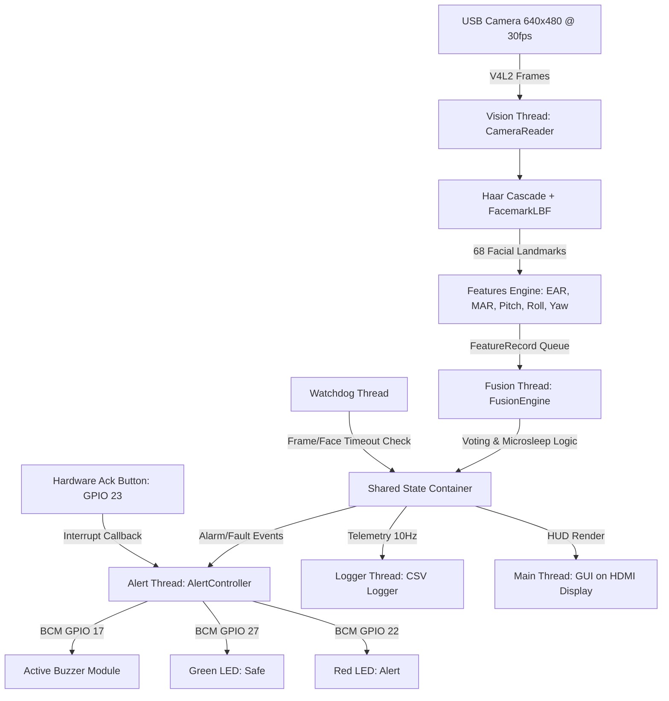
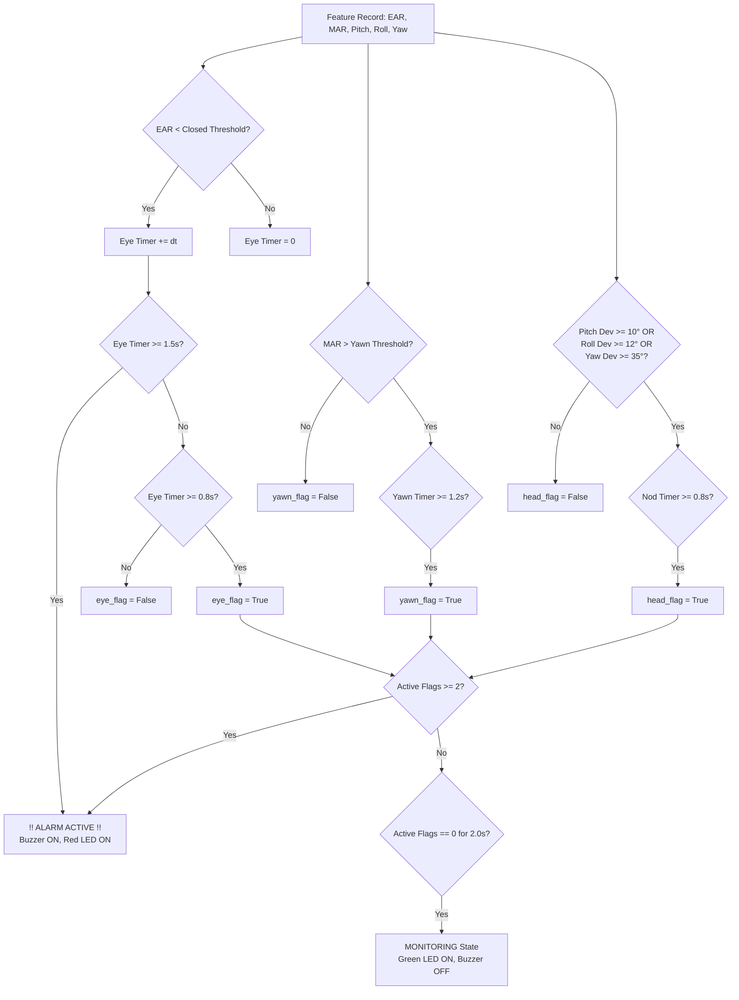

# Driver Drowsiness Detection System: Technical Architecture & Detection Specification

This document provides a comprehensive technical overview of the **Driver Drowsiness Detection System** implemented on the **Raspberry Pi 4 Model B**. It details the hardware/software stack, computer vision algorithms, mathematical formulations, detection thresholds, temporal windows, and decision fusion logic.

---

## 1. System Technology Stack



### 1.1 Hardware Specifications
| Subsystem | Component | Role & Specifications |
|:---|:---|:---|
| **SBC Processor** | Raspberry Pi 4 Model B | Broadcom BCM2711, Quad-core ARM Cortex-A72 (ARMv8) 64-bit @ 1.5 GHz / 1.8 GHz |
| **Memory** | 4GB / 8GB LPDDR4-3200 SDRAM | High-bandwidth shared memory for zero-copy frame buffer processing |
| **Camera Sensor** | USB UVC Webcam | 640×480 resolution @ 30 FPS, native Video4Linux2 (`V4L2`) capture backend |
| **Audio Alert** | 3-Pin Active Buzzer Module | Transistor-driven, active-low logic on BCM GPIO 17 (Physical Pin 11); powered via 3.3V rail (Pin 1) |
| **Visual Indicators** | 5mm Diffused LEDs | Green Status LED on BCM GPIO 27 (Pin 13); Red Alert LED on BCM GPIO 22 (Pin 15) with 220 Ω resistors |
| **Driver Control** | Tactile Push Button | Physical acknowledge button on BCM GPIO 23 (Pin 16) with software-enabled internal pull-up |
| **Display Output** | Micro-HDMI | Direct X11 / Wayland framebuffer preview with real-time HUD metrics |

### 1.2 Software & Framework Stack
- **Operating System**: Raspberry Pi OS 64-bit (Debian 12 Bookworm, Linux kernel 6.6+)
- **Runtime Environment**: Python 3.13 / 3.12 within an isolated virtual environment (`~/drowsy/venv`)
- **Computer Vision**:
  - **OpenCV**: Core image processing, color space conversion, affine transformations, and solvePnP.
  - **FacemarkLBF (`cv2.face.createFacemarkLBF`)**: Highly optimized Local Binary Features regressor fitting 68 landmarks in **2–3 ms** on ARM Cortex-A72.
  - **Frontal Haar Cascade**: Multi-scale face detection enhanced with **multi-angle ROI tilt recovery** ($\pm 18^\circ$) and persistent driver lock-on.
  - **MediaPipe Tasks API (Fallback)**: 468-point 3D Face Landmarker mesh.
- **Hardware I/O**: `lgpio` / `gpiozero` for memory-mapped, low-latency digital GPIO transitions.
- **Concurrency Model**: 5 concurrent threads (`Vision`, `Fusion`, `Alert`, `Watchdog`, `Main/GUI`) communicating via lock-free thread-safe queues and an atomic `SharedState` container.
- **Process Orchestration**: Linux `systemd` user service (`drowsy.service`) with enabled user linger (`loginctl enable-linger soham`) and autostart XDG desktop integration (`~/.config/autostart/drowsy.desktop`).

---

## 2. Facial Landmark & Biometric Algorithms

The system computes five primary biometric parameters per frame using normalized 68-point facial landmarks:

```
                  17..21 (R Eyebrow)        22..26 (L Eyebrow)
                       36..41 (R Eye)          42..47 (L Eye)
                                     27..35 (Nose)
                                     48..67 (Mouth)
                                     0..16 (Jawline)
```

### 2.1 Eye Aspect Ratio (EAR)
Measures eyelid opening distance normalized by horizontal eye width. As the driver's eyes close, EAR drops toward zero:

$$\text{EAR} = \frac{||p_2 - p_6|| + ||p_3 - p_5||}{2 \times ||p_1 - p_4||}$$

- Computed independently for both eyes:
  - **Right Eye**: Points $[36, 37, 38, 39, 40, 41]$
  - **Left Eye**: Points $[42, 43, 44, 45, 46, 47]$
- **Average EAR**: $\text{EAR}_{\text{avg}} = \frac{\text{EAR}_{\text{left}} + \text{EAR}_{\text{right}}}{2}$

### 2.2 Mouth Aspect Ratio (MAR)
Measures mouth opening to detect yawning. To eliminate false yawn flags caused by resting lip thickness, the system calculates vertical distance between the **inner lip margins** (points 60–67):

$$\text{MAR} = \frac{||p_{61} - p_{67}|| + ||p_{62} - p_{66}|| + ||p_{63} - p_{65}||}{2 \times ||p_{60} - p_{64}||}$$

### 2.3 Head Pose Estimation (Pitch, Roll, Yaw)
Head orientation is decoupled into independent angular axes to prevent gimbal lock:

1. **Forward Nod Pitch ($\theta_{\text{pitch}}$)**:
   Estimated using `cv2.solvePnP` against an anthropometric 3D generic facial model (nose tip, chin, eye corners, mouth corners). Normalized into $[-90^\circ, +90^\circ]$. Negative pitch deviation indicates the head dipping downward toward the chest.
2. **Physical Shoulder Tilt Roll ($\theta_{\text{roll}}$)**:
   Calculated directly from the inter-ocular axis:
   $$\theta_{\text{roll}} = \operatorname{arctan2}(\Delta y_{\text{eyes}}, \Delta x_{\text{eyes}}) = \operatorname{arctan2}(y_{45} - y_{36}, x_{45} - x_{36})$$
   - $\theta_{\text{roll}} < 0$: Head tilted toward driver's **right shoulder**.
   - $\theta_{\text{roll}} > 0$: Head tilted toward driver's **left shoulder**.
3. **Physical Head Turn Yaw ($\theta_{\text{yaw}}$)**:
   Calculated from the orthogonal projection of the nose tip relative to the eye midpoint span, capturing left/right head turn independently of 3D projection error.

### 2.4 PERCLOS (Percentage of Eye Closure)
Calculates the proportion of time the driver's eyes remain closed ($\ge 80\%$ closed) over a sliding temporal window of 30 seconds:

$$\text{PERCLOS} = \frac{\sum_{t \in W} \Delta t_{\text{closed}}}{T_{\text{window}}}$$

---

## 3. Detection Parameters & Timing Windows

The detection engine combines fast instantaneous alerts with cumulative temporal filters to prevent false alarms from ordinary blinks, speaking, and mirror checks:

| Parameter | Configuration Key | Default Value | Detection Purpose |
|:---|:---|:---|:---|
| **Eye Closure Duration** | `ear_closure_duration_sec` | **`0.80 s`** | Eyes must remain continuously below closed threshold for 0.8s to set `eye_flag`. Normal blinks (100–300 ms) are ignored. |
| **Microsleep Override** | `microsleep_duration_sec` | **`1.50 s`** | If eyes remain closed for $\ge 1.5$ seconds, **ALARM ON** triggers immediately, bypassing voting rules. |
| **Yawn Duration** | `yawn_duration_sec` | **`1.20 s`** | Mouth must remain continuously above yawn threshold for 1.2s to set `yawn_flag`. Talking or laughing is ignored. |
| **Head Nod / Tilt Duration** | `nod_duration_sec` | **`0.80 s`** | Head must remain tilted forward or sideways for 0.8s to set `head_flag`. Quick head adjustments are ignored. |
| **Pitch Nod Threshold** | `pitch_deviation_deg` | **`10.0°`** | Forward pitch dip from calibrated baseline required to indicate head dropping in sleep. |
| **Roll Tilt Threshold** | `roll_deviation_deg` | **`12.0°`** | Sideways shoulder tilt deviation (left or right) required to indicate sideways head slump. |
| **Yaw Turn Threshold** | `yaw_deviation_deg` | **`35.0°`** | Head turn deviation required to indicate driver distracted or turned away from road. |
| **PERCLOS Window** | `perclos_window_sec` | **`30.0 s`** | Sliding window for slow-onset cumulative fatigue assessment. |
| **Voting Threshold** | `voting_threshold` | **`2 flags`** | Minimum simultaneous flags required to sound alarm (`EYE + HEAD` or `EYE + YAWN`). |
| **Alarm Clear Time** | `alarm_clear_duration_sec` | **`2.0 s`** | Continuous period with all flags cleared before alarm automatically resets to Normal. |
| **Acknowledge Cooldown** | `ack_cooldown_sec` | **`3.0 s`** | Button press silences alarm and suppresses re-triggering for 3.0 seconds. |
| **Face Lost Timeout** | `face_timeout_sec` | **`2.0 s`** | Absence of driver face for $> 2.0$s triggers camera fault (or sleep alarm if head slumped). |

---

## 4. Multi-Sensor Fusion & Decision Logic



### 4.1 Decision Hierarchy
1. **Critical Microsleep Override (Priority 1)**:
   $$\text{Eye Closure Duration} \ge 1.5\,\text{s} \implies \mathbf{ALARM\_ON}$$
2. **2-of-3 Temporal Voting (Priority 2)**:
   $$\sum(\text{eye\_flag}, \text{yawn\_flag}, \text{head\_flag}) \ge 2 \implies \mathbf{ALARM\_ON}$$
3. **Slumped Face-Lost Override (Priority 3)**:
   If driver face tracking is lost while `eye_flag = True` and head was nodding forward or tilted sideways $\implies \mathbf{ALARM\_ON}$ (driver collapsed asleep below camera view).
4. **Auto-Recovery**:
   When active flags drop to zero continuously for $\ge 2.0\,\text{s}$ (or driver presses acknowledge button), the system returns to $\mathbf{MONITORING}$ state (Green LED ON, Buzzer OFF).

---

## 5. Driver Calibration Procedure

Driver calibration tailors all absolute thresholds to the driver's unique facial physiology and vehicle mounting geometry in **15 seconds**:

1. **Acquisition Phase**: Collects $\approx 250 - 300$ baseline frames while driver sits alert with normal upright head orientation.
2. **Computed Baselines**:
   - $\text{EAR}_{\text{open}} = \operatorname{median}(\text{EAR}_{\text{samples}})$
   - $\text{MAR}_{\text{resting}} = \operatorname{median}(\text{MAR}_{\text{samples}})$
   - $\theta_{\text{pitch, base}} = \operatorname{median}(\text{Pitch}_{\text{samples}})$
   - $\theta_{\text{roll, base}} = \operatorname{median}(\text{Roll}_{\text{samples}})$
   - $\theta_{\text{yaw, base}} = \operatorname{median}(\text{Yaw}_{\text{samples}})$
3. **Threshold Derivation**:
   $$\text{EAR}_{\text{closed\_threshold}} = \text{EAR}_{\text{open}} \times 0.80$$
   $$\text{MAR}_{\text{yawn\_threshold}} = \text{MAR}_{\text{resting}} + 0.15$$
   $$\text{Pitch}_{\text{alarm}} = \theta_{\text{pitch, base}} - 10.0^\circ$$
   $$\text{Roll}_{\text{alarm}} = \theta_{\text{roll, base}} \pm 12.0^\circ$$
   $$\text{Yaw}_{\text{alarm}} = \theta_{\text{yaw, base}} \pm 35.0^\circ$$
4. **Persistence**: Saved to `calibration.yaml` and automatically merged at application startup.
